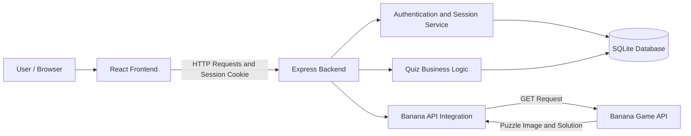

# Banana Quiz Challenge (Banana Arcade)

**CIS046-3 Software for Enterprise**  
Individual University Project

Banana Quiz Challenge, also known as **Banana Arcade**, is a distributed web application developed using React, Node.js, Express, and SQLite. It integrates with the official Banana Game API to provide users with interactive banana puzzles.

Registered users can log in, select a difficulty level (Easy, Medium, or Difficult), complete five banana puzzles, and view their scores. Quiz results are calculated and stored by the backend.

## 1. Project Objectives

The project demonstrates four key themes of the Software for Enterprise module:

1. **Version Control:** Using Git and GitHub to manage source code and maintain meaningful project changes.
2. **Event-Driven Programming:** Handling form submissions, button clicks, user interactions, and asynchronous API updates.
3. **Interoperability:** Communicating with the Banana Game API through HTTP requests, processing responses, and handling errors.
4. **Virtual Identity:** Implementing user registration, login, server-side sessions, logout, and access control.

## 2. Technology Stack

| Layer | Technology |
|---|---|
| Frontend | React (JavaScript) and Vite |
| Styling | CSS |
| Backend | Node.js and Express |
| Database | SQLite (`better-sqlite3`) |
| Sessions | `express-session` with SQLite storage |
| Password Security | `bcryptjs` |
| HTTP Client | Fetch API |
| Testing | Node.js test runner and Supertest |

## 3. System Architecture

The application follows a distributed architecture consisting of a React frontend, Express backend, SQLite database, and external Banana Game API.



### Purpose of Each Layer

- **React Frontend:** Displays application pages, captures user interactions, and manages loading, success, and error states. It does not determine the official quiz score.
- **Express Backend:** Validates requests, manages sessions, communicates with SQLite, and handles requests to the Banana Game API.
- **Authentication and Session Service:** Handles registration, password hashing, login, session creation, logout, and password reset.
- **Quiz Business Logic:** Manages quiz sessions, checks submitted answers, enforces timers, calculates scores, and saves results against the authenticated user.
- **Banana API Integration:** `backend/src/services/bananaService.js` is the only module that talks to the external API. It validates the JSON, maps it to an internal puzzle, times out slow requests, and retries once after a temporary failure.
- **SQLite Database:** Stores user accounts, session information, and quiz results.

## 4. Project Structure

The main project structure is organised as follows:

```text
Banana-Quiz-Challenge/
│
├── README.md
├── .env.example
├── .gitignore
│
├── docs/
│   ├── CIS046-3_Faculty_Self_Assessment.md
│   └── technical-decisions.md
│
├── backend/
│   ├── src/
│   │   ├── index.js
│   │   ├── app.js
│   │   ├── config.js
│   │   ├── db.js
│   │   ├── middleware/
│   │   ├── routes/
│   │   ├── services/
│   │   │   └── difficulty.js
│   │   └── store/
│   │
│   └── tests/
│
└── frontend/
    ├── index.html
    └── src/
        ├── api/
        ├── components/
        ├── context/
        ├── game/
        └── pages/
```

## 5. Installation and Setup

### Requirements

- Node.js 18 or later
- npm
- Git

### Clone the Repository

Open a terminal and run:

```bash
git clone https://github.com/deeyoooooooo/Banana-Quiz-Challenge.git
cd Banana-Quiz-Challenge
```

### Configure Environment Variables

Create a local environment file using the provided example.

**Windows PowerShell:**

```powershell
Copy-Item .env.example .env
```

**macOS / Linux:**

```bash
cp .env.example .env
```

Open `.env` and replace the placeholder `SESSION_SECRET` with a unique secret value.

Do not commit `.env` or any real credentials to GitHub. The `.env.example` file contains placeholders and is safe to share.

### Install Dependencies

Install the backend dependencies:

```bash
cd backend
npm install
```

Install the frontend dependencies:

```bash
cd ../frontend
npm install
```

### Environment Variables

The application uses the following environment variables:

| Variable | Purpose |
|---|---|
| `PORT` | Backend server port (default: 3001) |
| `NODE_ENV` | Application environment |
| `SESSION_SECRET` | Secret used to sign session cookies |
| `FRONTEND_ORIGIN` | Allowed frontend origin for CORS |
| `BANANA_API_URL` | Banana Game API endpoint |
| `BANANA_TIMEOUT_MS` | How long to wait for the Banana API before timing out (default: 10000) |
| `DATABASE_PATH` | SQLite database file location |
| `RESET_TOKEN_MINUTES` | How long a password-reset token stays valid (default: 15) |

There is no Banana API key configured because the official API documentation does not specify one.

### Database Setup

The application uses SQLite, so no separate database server is required.

When the backend starts for the first time, `backend/src/db.js` creates the database and its required tables:

- `users`
- `quiz_results`
- `sessions`
- `password_resets`

Existing databases are updated when necessary. Database migrations add missing result columns without deleting existing users or scores.

Historical results without a recorded difficulty are treated as Easy, and their maximum score is populated using the original five-question scoring scale.

### Start the Application

Run the backend in one terminal:

```bash
cd backend
npm start
```

Run the frontend in a second terminal:

```bash
cd frontend
npm run dev
```

Open the application in your browser:

**http://localhost:5173**

The Vite development server proxies `/api` requests to the Express backend at `http://localhost:3001`.

## 6. Banana Game API Integration

The application integrates with the external Banana Game API.

**Official documentation:**  
https://marcconrad.com/uob/banana/doc.php

| Item | Description |
|---|---|
| Base URL | `http://marcconrad.com/uob/banana/api.php` |
| Output format | JSON (`out=json`) |
| Optional Base64 | `base64=yes` embeds the image |
| Authentication | None documented |
| Response | Puzzle image URL and numerical solution |

The application uses the following endpoint:

```text
http://marcconrad.com/uob/banana/api.php?out=json
```

The API returns one banana puzzle rather than a multiple-choice question paper. Users view the puzzle image and submit a digit between 0 and 9.

The backend adapter in `bananaService.js` is the only place that knows the external JSON field names. It checks that `question` is present and that `solution` is a digit from 0 to 9, then returns an internal puzzle object. The solution stays in the server-side session. API responses sent to React contain the image URL, the server deadline, and the score so far. They do not contain the solution. Easy mode can provide an even-or-odd hint without revealing the answer.

Each request uses a 10 second timeout (`BANANA_TIMEOUT_MS`). If the call fails because of a network error, a timeout, or a temporary HTTP status (408, 429, 500, 502, 503, or 504), the adapter tries exactly once more. A malformed body or a permanent HTTP error such as 404 is not retried. If both attempts fail, the user sees: "The quiz service is temporarily unavailable. Please try again later." The server logs the technical code. It does not send a stack trace, and it does not substitute a hardcoded puzzle.

The official Banana API endpoint is HTTP, not HTTPS. That limitation belongs to the external service.

Tests use a mock adapter to simulate API responses. Mock data is not presented as a live API result.

## 7. Authentication and Session Management

The application includes user registration and login using server-side sessions.

The authentication process works as follows:

1. Users register with a username, email, and password.
2. The server validates the submitted information.
3. Passwords are hashed using `bcryptjs` before being stored.
4. Duplicate email addresses are rejected.
5. During login, the submitted password is compared with the stored password hash.
6. Successful authentication creates a server-side session stored in SQLite.
7. The session cookie uses `HttpOnly` and `SameSite=Lax` settings. The `Secure` option is enabled in production.
8. Protected frontend routes check `/api/auth/me`, while protected backend routes use authentication middleware.
9. Logging out calls `req.session.destroy`, which deletes the SQLite session row. The old cookie no longer matches a logged-in user.
10. A forgotten password creates a random token. Only its SHA-256 hash is stored, with an expiry time. In development the reset link is printed in the backend console. It is not returned by the API. Using the link stores a new bcrypt password hash and marks the token used. Expired and used tokens are rejected. The response does not say whether the email address is registered.

Server-side sessions and `HttpOnly` cookies were chosen so JavaScript in the browser cannot read the session identifier. Storing a JWT in `localStorage` would expose it to any script running on the page. OAuth is not implemented; registration and login are handled by this application.

Frontend login flags are not treated as proof of authentication. Database queries also include the authenticated user's ID to prevent users from accessing another user's quiz history.

### Password reset demonstration

1. Register and log out.
2. Open **Forgot password?** on the login page and submit the registered email.
3. Copy the reset link from the backend terminal. It is only printed when `NODE_ENV=development`.
4. Open that link, choose a new password, and log in with it.
5. Confirm the old password no longer works and the same link cannot be used again.

## 8. Difficulty Levels and Scoring

The difficulty rules are defined in `backend/src/services/difficulty.js`. The backend is responsible for enforcing the rules and calculating scores.

| Mode | Description | Timer | Points per Correct Answer | Hint | Maximum Score |
|---|---|---:|---:|---|---:|
| Easy | Relax and Practice | None | 10 | Even / Odd | 50 |
| Medium | Challenge Yourself | 30 seconds | 20 | None | 100 |
| Difficult | Test Your Skills | 15 seconds | 30 | None | 150 |

Each quiz consists of five puzzles.

The `POST /api/quiz/start` endpoint requires a valid difficulty level. Missing difficulty values default to Easy for compatibility with older clients.

The backend does not trust client-submitted scores, remaining time, or user IDs.

For timed difficulties, each active puzzle stores its start time and deadline in the server session. The quiz response includes `serverDeadline`, which is that server timestamp. The browser countdown uses it only as a display. The backend ignores any deadline or score sent by the browser and compares `Date.now()` on the server with the stored deadline.

Answers submitted after the deadline receive zero points and are counted as unanswered, even if the submitted digit is correct. A correct digit sent after expiry therefore does not increase the score.

## 9. Event-Driven Programming

The application uses event handlers to respond to user interactions and asynchronous operations.

The following examples are implemented in the project:

| User Event | Handler | Functionality |
|---|---|---|
| Registration form submission | `handleSubmit` in `Register.jsx` | Validates registration details and sends a request to the backend. |
| Login form submission | `handleSubmit` in `Login.jsx` | Authenticates the user and handles login errors. |
| Start Playing / Difficulty selection | `handleStartQuiz` in `Dashboard.jsx` | Starts a quiz using the selected difficulty. |
| Digit selection | `handleSelect` in `Quiz.jsx` | Stores and highlights the selected answer. |
| Submit Answer | `handleSubmit` in `Quiz.jsx` | Submits the answer and displays the result or next puzzle. |
| Countdown reaches zero | `handleTimeout` in `Quiz.jsx` | Sends a timeout request. The server accepts it only after its own deadline. |
| Forgot password | `handleSubmit` in `ForgotPassword.jsx` | Asks the server to prepare a reset link. |
| New password | `handleSubmit` in `ResetPassword.jsx` | Submits the token and replacement password. |
| Hint selection | `handleHint` in `Quiz.jsx` | Requests an Easy-mode hint. |
| Quit confirmation | `handleQuit` in `Quiz.jsx` | Abandons the active quiz without saving a completed result. |
| Play Again | `handlePlayAgain` in `Results.jsx` | Starts another quiz using the previous difficulty. |
| Logout | `handleLogout` in `Layout.jsx` | Ends the session and returns the user to the appropriate page. |
| Asynchronous API updates | Loading and error state handlers | Display loading messages, errors, and updated application states. |

These examples demonstrate how user events trigger frontend logic, backend requests, and visible application updates.

## 10. Git and Version Control

The project is maintained using Git and GitHub.

**Repository:**  
https://github.com/deeyoooooooo/Banana-Quiz-Challenge

Git is used to track source-code changes, organise development work through feature branches, and maintain a clear project history.

The repository workflow includes:

- Committing meaningful changes.
- Using branches to separate development work.
- Pushing changes to GitHub.
- Reviewing and merging changes through Pull Requests.
- Using Git tags to identify important project versions.

The `.gitignore` file excludes dependencies, environment files, SQLite databases, logs, and generated build files from version control.

## 11. Testing

The backend tests use the Node.js test runner and Supertest.

To execute the test suite:

```bash
cd backend
npm test
```

The tests cover areas including:

- User authentication and session handling.
- Banana API response handling.
- CSRF rejection.
- Password hashing, reset tokens, expiry, reuse, and session invalidation.
- Banana API success, timeout, one retry, permanent HTTP errors, and malformed data.
- Database migration.
- Difficulty validation, timing, scoring, and late answers.
- User-specific quiz result access.
- Repeated answer submissions.
- Five-question quiz behaviour.
- Public quiz rules.

## 12. Security Measures

The application includes several security measures:

- Password hashing using `bcryptjs`.
- SQLite-backed session storage instead of the default in-memory session store.
- `HttpOnly` and `SameSite` session cookies.
- Secure cookies in production.
- Restricted CORS configuration using `FRONTEND_ORIGIN`.
- CSRF token validation for cookie-authenticated POST requests.
- Parameterised SQL queries.
- Login rate limiting.
- Server-side input validation.
- Environment variables for configuration and secrets.
- User-specific access to quiz history.

## 13. Known Limitations

The project has some limitations:

- The Banana Game API is an external teaching service and may be slow, unavailable, or subject to changes.
- The documented Banana API uses HTTP rather than HTTPS.
- The API provides the puzzle solution along with the puzzle. Although the application keeps the solution away from the browser, someone accessing the third-party API directly can still obtain it.
- Session data is stored locally in SQLite rather than in a shared session store for multiple servers.
- Password reset is development-only: the link is written to the server console. There is no email provider, and this delivery method must not be used in production.
- OAuth is not implemented.
- The application is not production-ready. It is a single-server assessment build.
- Role-based administrator access has been omitted to keep the project scope manageable.

The reasons for these choices are summarised in `docs/technical-decisions.md`.

## 14. Acknowledgements

- **Banana Game API:** Marc Conrad — https://marcconrad.com/uob/banana/doc.php
- **Banana Game resources:** https://marcconrad.com/uob/banana/
- **Related repository:** https://github.com/marcconrad/comparativeintegratedsystems
- **Software packages:** Express, `express-session`, `bcryptjs`, `better-sqlite3`, CORS, dotenv, express-rate-limit, React, Vite, React Router, and Supertest.
- **Academic materials:** CIS046-3 Software for Enterprise assignment brief and student guide, University of Bedfordshire.
- **AI assistance:** Cursor was used during parts of development. The student is responsible for understanding the implemented code and acknowledging AI assistance in accordance with the assignment requirements.

### Student Acknowledgement

Add the names of any classmates, forums, tutorials, or other resources personally used during development, where applicable.